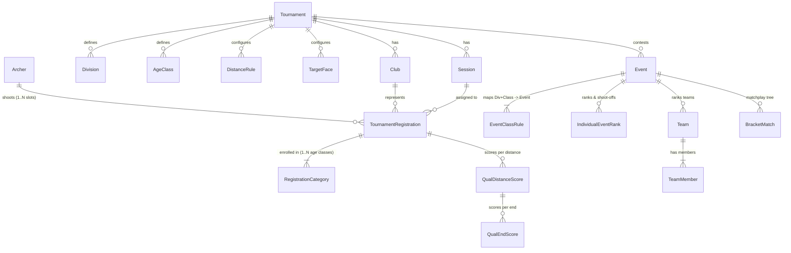

# IANSEO-ON-STEROIDS — PostgreSQL Database Design Guide

This document explains the normalized PostgreSQL database architecture you will build across the User Stories, why each table exists, and how it improves upon legacy Ianseo's MyISAM schema while keeping 100% of its capabilities.

---

## 1. Key Improvements Over Legacy Ianseo's Schema

| Legacy Ianseo Design Flaw | Our Normalized PostgreSQL Solution |
| :--- | :--- |
| **`Entries` is 1:1 with `Qualifications`**: One archer (`EnId`) can only hold one `EnClass`, one `QuTargetNo`, and one score. | **3-Tier Separation (`Archer` $\rightarrow$ `TournamentRegistration` $\rightarrow$ `RegistrationCategory`)**: One person (`Archer`) can have multiple shooting slots (`TournamentRegistration`), AND a single shooting slot can rank across multiple age categories (`RegistrationCategory`)! |
| **Hardcoded `QuD1Score` .. `QuD8Score`**: 60+ repetitive columns in `Qualifications`. | **Normalized `QualDistanceScore` & `QualEndScore` tables**: Clean `(registrationId, distanceNumber)` rows supporting 1 to $N$ distances plus end-by-end arrow coordinates. |
| **Paired Rows in `Finals`**: Every match is split across two separate rows (`FinMatchNo = 8` and `FinMatchNo = 9`) joined with `IF(FinMatchNo % 2 = 0, ...)`. | **Normalized `BracketMatch` + `BracketGrid`**: Stores `matchNoEven` (`0, 2, 4..126`) with explicit `competitor1` and `competitor2` relations while preserving Ianseo's exact `Grids` binary tree math ($\lfloor m / 2 \rfloor$). |
| **Serialized PHP Blobs (`ToOptions`) & Zero-Dates (`0000-00-00`)**: Fails on modern databases and cannot be queried. | **Typed JSONB columns & proper nullable `TIMESTAMPTZ` / `DATE` types** with PostgreSQL foreign keys and cascading deletes. |

---

## 2. Entity-Relationship Diagram

---

## 3. Core Schema Models Reference (Built Incrementally by User Story)

### Epic 1 Models (`US-02`): Tournament Configuration
- **`Tournament`**: Stores competition metadata, active ruleset (`locRule`, `tourTypeId`, `subRule`), scoring definitions (`goldsLabel`, `xnineLabel`, `goldsChars`, `xnineChars`), and custom rule policies (`allowMultiClass`, `multiClassMode`: `SEPARATE_SESSIONS` | `SHARED_SCORE` | `BOTH`).
- **`Session`**: Shooting lines (`QUALIFICATION`, `ELIMINATION`, `FINAL`), number of bales (`numTargets`), and archers per bale (`archersPerTarget`).
- **`Division`**: Bow styles (`R` Recurve, `C` Compound, `B` Barebow, `L` Longbow, `I` Instinctive).
- **`AgeClass`**: Age and gender classes (`M`, `W`, `JM`, `JW`, `CM`, `CW`, `MM`, `MW`) with `ageFrom`, `ageTo`, `gender`, and `validShootUpClasses` (array of classes this age group is eligible to enter).
- **`DistanceRule`**: Maps `(divisionPattern, classPattern, distanceNumber)` $\rightarrow$ `distanceLabel` (e.g. `70m-1`), `endsCount` (`6`), `arrowsPerEnd` (`6`), `maxScore` (`360`).
- **`TargetFace`**: Defines target face rings (`TrgOutdoor`, `TrgCOOutdoor`, `TrgIndSmall`, `TrgCOIndSmall`, `TrgField`, `Trg3D`) and diameter in cm (`122`, `80`, `60`, `40`).

### Epic 2 Models (`US-04`): Archers & Multi-Category Registrations
- **`Club`**: Represents countries, states, or local archery clubs (`code`, `name`, `iocCode`).
- **`Archer`**: The unique human athlete (`bibCode`, `firstName`, `lastName`, `gender`, `birthDate`, `primaryClubId`, `photoUrl`, `isWheelchair`).
- **`TournamentRegistration`**: A physical shooting assignment on the field:
  - Links `archerId` to `tournamentId`, `divisionCode`, `primaryClassCode`, `sessionOrder`, `baleNumber`, `targetLetter`, and `targetNoFormatted` (`"1005A"`).
  - Holds cached qualification totals (`totalScore`, `totalHits`, `totalGolds`, `totalXnines`) and accreditation state (`status`, `feePaid`, `checkedInAt`, `equipmentInspectedAt`).
- **`RegistrationCategory`**: Allows one `TournamentRegistration` to compete in **one or multiple age classes** (`divisionCode`, `classCode`, `isPrimary`, `categoryRank`, `subClassRank`).

### Epic 3 Models (`US-09`): Normalized Qualification Scores
- **`QualDistanceScore`**: One row per `(registrationId, distanceNumber)` storing `score`, `hits`, `golds`, `xnines`, `distanceRank`, and `arrowString`.
- **`QualEndScore`**: One row per `(qualDistanceScoreId, endNumber)` storing `arrowString`, `arrowPositionsJson` (`[{x, y, letter, score}]`), and `endScore`.

### Epic 4–6 Models (`US-12`, `US-15`, `US-16`): Events, Teams, Eliminations & Brackets
- **`Event`**: Individual or Team championship event (`code`, `isTeamEvent`, `isMixedTeam`, `firstPhase`, `matchMode`: `SET_SYSTEM` | `CUMULATIVE`, `finEnds`, `finArrows`, `finSO`).
- **`EventClassRule`**: Maps which `(divisionCode, classCode)` combinations feed into an `Event` and how many archers per slot (`requiredCount`).
- **`IndividualEventRank`**: Stores qualification rank within an `Event`, cutoff shoot-off flags (`soFlag`), and final championship rank (`finalRank`).
- **`Team` & `TeamMember`**: Club teams formed automatically or manually from top qualifiers.
- **`EliminationEntry`**: Pool elimination round 1 and 2 scores and ranks.
- **`BracketGrid` & `BracketMatch`**: Binary tree matchplay table (`matchNoEven`, `matchNoOdd`, `phase`, scores, set points, arrowstrings, coordinates, schedule, and live broadcast flag).
